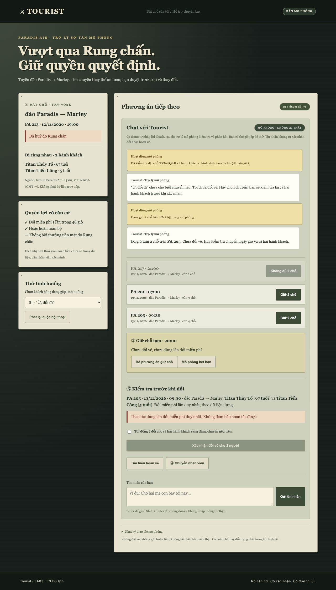

# Tourist · LAB5 T3 Du lịch

Thiết kế trợ lý đổi chuyến khi chuyến bị huỷ: AI tìm và giữ phương án, khách duyệt trước khi đổi, nhân viên xử lý ngoại lệ. Dữ liệu hoàn toàn giả của hãng YmirAirline.

- [Spec: phạm vi, 8 rủi ro, UX khi sai, mức tự chủ, demo](spec.md)
- [Prototype HTML](prototype/index.html) — tải repo rồi mở bằng trình duyệt
- [Cách chạy và bấm thử](prototype/README.md)
- [Kết quả kiểm tra](prototype/QA.md)

Có ô chat mô phỏng để gõ câu hỏi, hỗ trợ tiếng Việt có/không dấu và phản hồi theo quy tắc. Không cần API key hay cài dependency. Có thêm chế độ OpenAI qua backend local; xem hướng dẫn trong prototype/README.md. Không kết nối hãng bay. GitHub hiển thị mã HTML; để bấm giao diện hãy mở file local hoặc chạy server theo hướng dẫn.

## Trước khi nộp

- [ ] Điền đúng 3 thành viên, mã học viên, bàn/zone và phân công thực tế ở đầu spec.
- [ ] Nhóm tự xếp mức cho các tool, ghi khác biệt và quyết định thật; mỗi người hiểu phần của mình.
- [ ] Bổ sung ca lạ nhận tại demo và điều chỉnh sau demo.
- [ ] Kiểm tra repo công khai và chọn đúng nhánh có bài hoàn thiện khi nộp.
- [ ] Nộp trước 23:59 ngày 12/11/2026 GMT+7 theo kênh giảng viên thông báo.

Nguồn: [đề LAB5](https://github.com/VinUni-AI20k/K5-L3-Day05-AI-Product-UX-Autonomy), [track T3](https://github.com/VinUni-AI20k/K5-L3-Day05-AI-Product-UX-Autonomy/blob/main/tracks/t3-travel.md). Chỉ dùng template spec và fixture từ đề, không đưa toàn bộ đề hoặc prototype mẫu vào bài.
